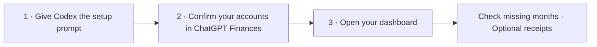

# Spending Atlas

One local dashboard for your bank spending, refunds, and trips. Bring your own ChatGPT Finances accounts and see what’s missing before relying on yearly totals.



## Start with Codex

Paste this into a new Codex chat:

```text
Set up Spending Atlas for me from https://github.com/sohumsanu/spending-atlas.
Clone it into a new local folder, read CODEX_SETUP.md, and follow it through
to a working dashboard. Use my own ChatGPT Finances connection. Do the local
setup and checks in the background. Ask me only for account decisions or
sign-ins that need my input. Give me the link when it is ready.
```

**Have handy** · Codex, Python 3.10 or newer, and access to your own ChatGPT Finances account. If Finances is unavailable or an account has missing history, Codex can help import a bank CSV. Amazon and Costco are optional.

| In the dashboard | What you can do |
| --- | --- |
| **Overview** | See yearly and monthly net spending and what drove it. |
| **Setup → Check coverage** | Compare verified periods against the year and get a Codex prompt for gaps. |
| **Categories & trips** | Recategorize a purchase, link a refund, or ask Codex to make an edit. |

**Your data stays in your local ledger.** The public repo contains the app and setup instructions. Keep statements, exported transactions, receipts, and backups in the ignored `.finance-data/` folder. Codex and connected services process the data used for requests you authorize.

[Full Codex setup workflow](CODEX_SETUP.md) · [Manual setup and troubleshooting](START-HERE.md)
