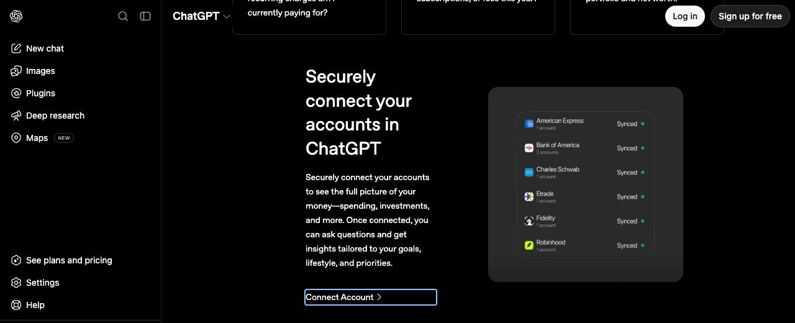

# Spending Atlas

A local dashboard for spending, refunds and reimbursements, and trips. Import transaction CSVs from your banks or bring in accounts through ChatGPT Finances.

## Start with Codex

Paste this into a local Codex chat.

```text
Set up Spending Atlas for me from https://github.com/sohumsanu/spending-atlas.
Clone it locally, read CODEX_SETUP.md, and launch the dashboard. Ask me
whether I want to import bank CSVs or use ChatGPT Finances. Keep my data
local. Give me the dashboard link once you verify it opens.
```

### Start from a terminal

You’ll need Git and Python 3.10 or newer. The dashboard has no Python package dependencies.

```sh
git clone https://github.com/sohumsanu/spending-atlas.git
cd spending-atlas
python3 bootstrap.py --open
```

On Windows use `py -3 bootstrap.py --open`. Open the local URL printed by the launcher if the browser does not open automatically.

## Add your transactions

In **Setup**, choose the source you want.

- **Use files from your bank** works without a ChatGPT Finances connection. Sign in to your bank in your browser and download one account’s transaction CSV. In Spending Atlas, choose the account nickname, review the column mapping and preview, then import. Repeat with the same nickname for later downloads. Setup shows how to find exports at Citi, Bank of America, and Capital One.
- **Use ChatGPT Finances** uses your existing connection in Codex. If you still need to link accounts, follow the screenshots below.

### Connect your accounts in ChatGPT Finances

**You’ll need** Access to ChatGPT Finances and Codex signed into the same ChatGPT account. OpenAI lists Finances for eligible U.S. users on Free, Go, Plus, and Pro. [ChatGPT Finances availability and setup](https://help.openai.com/en/articles/20001222-finances-in-chatgpt)

1. Open [ChatGPT Finances](https://chatgpt.com/finances) and sign in. In Finances, choose **Get started**. You can also type `@Finances, connect my accounts` in a ChatGPT conversation.

   [](https://chatgpt.com/finances)

2. Choose **Connect with Plaid** when prompted. Complete the bank sign-in yourself. Repeat for every institution you want included and select every relevant checking, savings, and credit card account at each institution. Include payment accounts you use for spending or reimbursements. The public page below shows the entry point and an example of synced institutions.

   [](https://chatgpt.com/finances)

3. Return to Finances and open **Accounts**. Compare the list with the accounts you used this year, check the last sync, and resolve anything marked **Action required**. Keep a list of any unsupported accounts or missing statement periods. Codex can use CSVs for those gaps. [OpenAI’s account-linking and sync guide](https://help.openai.com/en/articles/20001222-finances-in-chatgpt)

| In the dashboard | What you can do |
| --- | --- |
| **Overview** | See yearly and monthly net spending and what drove it. |
| **Months** | Compare category totals and monthly averages over the past 3, 6, or 12 months. Select a month or category amount to see the transactions. |
| **Setup → Check coverage** | Confirm the account list, see unverified dates, and get a Codex prompt for those gaps. |
| **Categories & trips** | Recategorize a purchase, link a refund, or ask Codex to make an edit. |

### Monthly spending

The Months report compares total spending with three views that exclude student loans, rent, or both. Averages use months with recorded activity. You can exclude the current month if you want to compare completed months. Linked refunds and reimbursements reduce spending in the original purchase month. Category-only credits apply in the month received.

Use **Report settings** to add exact merchant names or statement descriptions for rent and student loan payments. These settings are saved in your browser and apply to the Months report.

### Spending and money movements

Atlas can categorize identifiable student loan payments, software and cloud charges, and taxes and government fees. Peer payments and cash withdrawals with an unknown purpose show up in Review and count as outflows. Internal transfers, credit-card payments, and returned payment attempts are listed in Categories and excluded from spending totals.

### Optional retailer receipts

Open **Setup → Optional receipts**. Turn on Amazon or Costco, use its sign-in link, then copy its Codex prompt. Sign in yourself on the retailer site. Amazon needs the cards you used and its completed payments to separate your purchases on a shared account. Costco warehouse receipts are under **Orders & Returns → In-Warehouse**. Suggestions for other retailers come from repeat shopping and grocery purchases in your ledger. You choose which merchant to investigate. [Costco receipt guide](https://customerservice.costco.com/app/answers/detail/a_id/10306)

### If the year has gaps

Overview flags when the selected year still needs review. **See coverage gaps** shows the unverified dates by bank or card. **Get Codex help** builds a prompt with masked account labels and exact ranges so Codex can check Finances and ask for only the missing statements. The current year is checked through today and past years through December 31. A gap means there is no coverage evidence yet. You can finish setup and come back to it.

**Your data stays in your local ledger.** The public repo contains the app and setup instructions. Keep statements, exported transactions, receipts, and backups in the ignored `.finance-data/` folder. Codex and connected services process the data used for requests you authorize.

[Full Codex setup workflow](CODEX_SETUP.md) · [Manual setup and troubleshooting](START-HERE.md)
