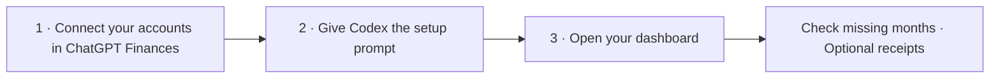
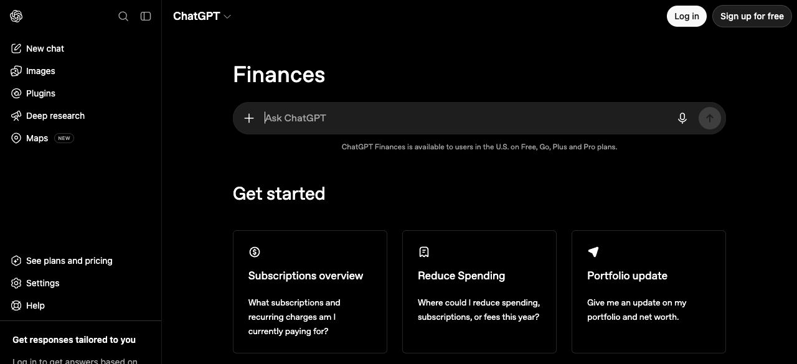

# Spending Atlas

One local dashboard for your bank spending, refunds, and trips. Bring your own ChatGPT Finances accounts and see what’s missing before relying on yearly totals.



Already connected? [Skip to the Codex prompt](#2-start-with-codex).

## 1. Connect your accounts in ChatGPT Finances

**You’ll need** Codex signed into the same ChatGPT account, Python 3.10 or newer, and access to ChatGPT Finances. OpenAI lists Finances for eligible U.S. users on Free, Go, Plus, and Pro. [ChatGPT Finances availability and setup](https://help.openai.com/en/articles/20001222-finances-in-chatgpt)

1. Open [ChatGPT Finances](https://chatgpt.com/finances) and sign in. In Finances, choose **Get started**. You can also type `@Finances, connect my accounts` in a ChatGPT conversation.

   [](https://chatgpt.com/finances)

2. Choose **Connect with Plaid** when prompted. Complete the bank sign-in yourself. Repeat for every institution you want included and select every relevant checking, savings, and credit card account at each institution. Include payment accounts you use for spending or reimbursements. The public page below shows the entry point and an example of synced institutions.

   [](https://chatgpt.com/finances)

3. Return to Finances and open **Accounts**. Compare the list with the accounts you used this year, check the last sync, and resolve anything marked **Action required**. Keep a list of any unsupported accounts or missing statement periods. Codex can use CSVs for those gaps. [OpenAI’s account-linking and sync guide](https://help.openai.com/en/articles/20001222-finances-in-chatgpt)

## 2. Start with Codex

Paste this into a new Codex chat:

```text
Set up Spending Atlas for me from https://github.com/sohumsanu/spending-atlas.
Clone it into a new local folder, read CODEX_SETUP.md, and follow it through
to a working dashboard. Use my own ChatGPT Finances connection. Do the local
setup and checks in the background. Ask me only for account decisions or
sign-ins that need my input. Give me the link when it is ready.
```

Use a regular local Codex chat with access to your checkout. If the Finances tool is unavailable in that chat, Codex can still start the dashboard and help import CSVs. Amazon and Costco are optional.

| In the dashboard | What you can do |
| --- | --- |
| **Overview** | See yearly and monthly net spending and what drove it. |
| **Setup → Check coverage** | Confirm the account list, see unverified dates, and get a Codex prompt for those gaps. |
| **Categories & trips** | Recategorize a purchase, link a refund, or ask Codex to make an edit. |

### Optional retailer receipts

Open **Setup → Optional receipts**. Turn on Amazon or Costco, use its sign-in link, then copy its Codex prompt. Sign in yourself on the retailer site. Amazon needs the cards you used and its completed payments to separate your purchases on a shared account. Costco warehouse receipts are under **Orders & Returns → In-Warehouse**. Suggestions for other retailers come from repeat shopping and grocery purchases in your ledger. You choose which merchant to investigate. [Costco receipt guide](https://customerservice.costco.com/app/answers/detail/a_id/10306)

### If the year has gaps

Overview flags when the selected year still needs review. **See coverage gaps** shows the unverified dates by bank or card. **Get Codex help** builds a prompt with masked account labels and exact ranges so Codex can check Finances and ask for only the missing statements. The current year is checked through today and past years through December 31. A gap means there is no coverage evidence yet. You can finish setup and come back to it.

**Your data stays in your local ledger.** The public repo contains the app and setup instructions. Keep statements, exported transactions, receipts, and backups in the ignored `.finance-data/` folder. Codex and connected services process the data used for requests you authorize.

[Full Codex setup workflow](CODEX_SETUP.md) · [Manual setup and troubleshooting](START-HERE.md)
